That's how I'd pose in my own fighter jet and my wife be clicking the picture, when performing in an airshow.
I'd take her every where in MY JET.

I like Tom Cruise; he is brilliant. I had lost the desire to be a fighter pilot; watching Cruise in Top Gun (1986), I want to be a fighter pilot again. I have spectacles now - around negative 0.75. So being a fighter pilot in an institution is impossible unless I get a surgery, which I don't plan on getting. Maybe I will. But my plan is to skip all the institutional bloat and buy my own jet. Jared Isaacman - I think that's his name - has a private MiG-29; both Indian Air Force and the Indian Navy have MiG-29s but different variants, the Navy is Mig-29K, and the Air Force has, Mig-29UPG. Jared Isaacman (read about him on the internet), he is actually a person I look up to - he's great, he's a prodigy. So I will buy one like he did - I like the "Fatback" variant...
All this because of Tom Cruise. I LOVE YOU MR. TOM CRUISE. The 24 year old Cruise in Top Gun (1986) is the perfect archetype I want to be like. He is fantastic, confident, beautiful, smart, intelligent and admirable and much more... I like his cocky-ness, if he even is that.

I am now also, besides jets, interested in Bush Flying. Bush flying in easy words is, taking your bush aircraft - a propeller - to different places in the wilderness. Fly (from home), land (in jungle), camp (somewhere in jungle), fly again.
I'll do that with my wife. Sure-thing it is.

Look at this image; one day I'll have this photo clicked of myself; look the background, look at the scenery and the jet, I want it:

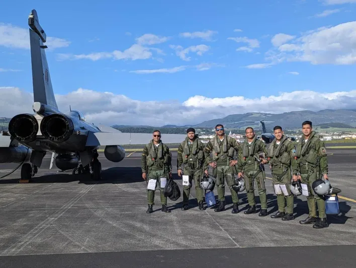
This is a Rafale by the way!

A few pictures of me in an air-show:

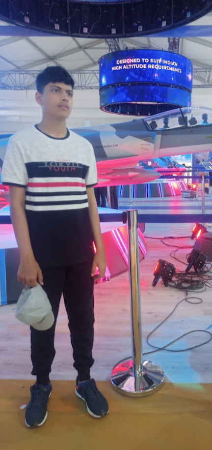

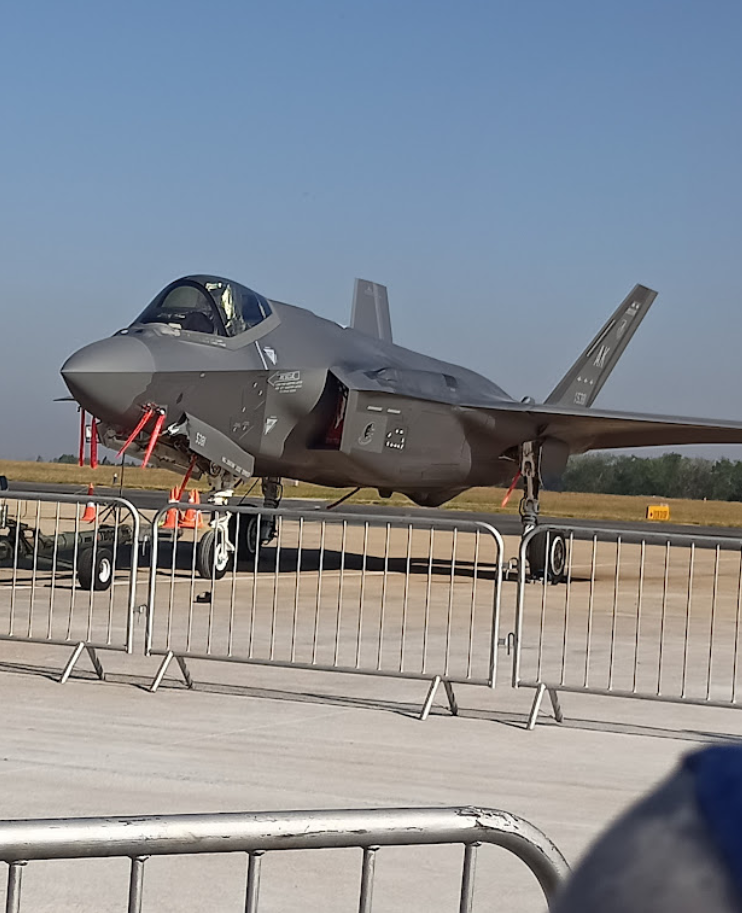

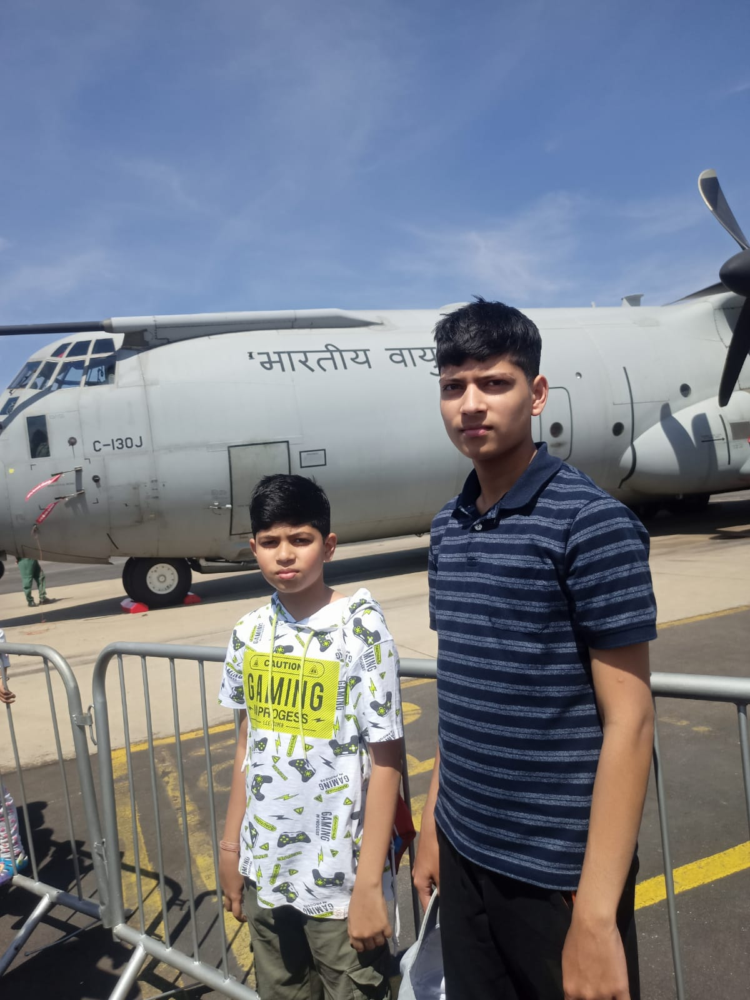

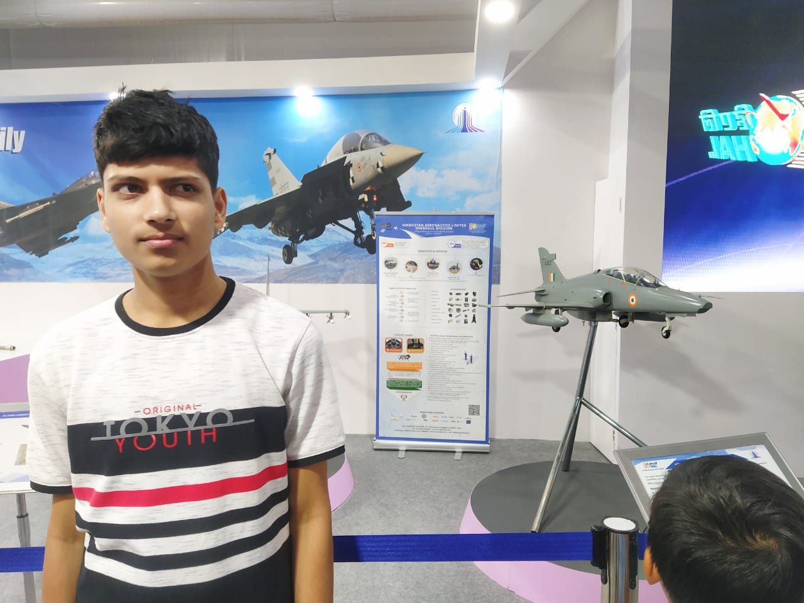

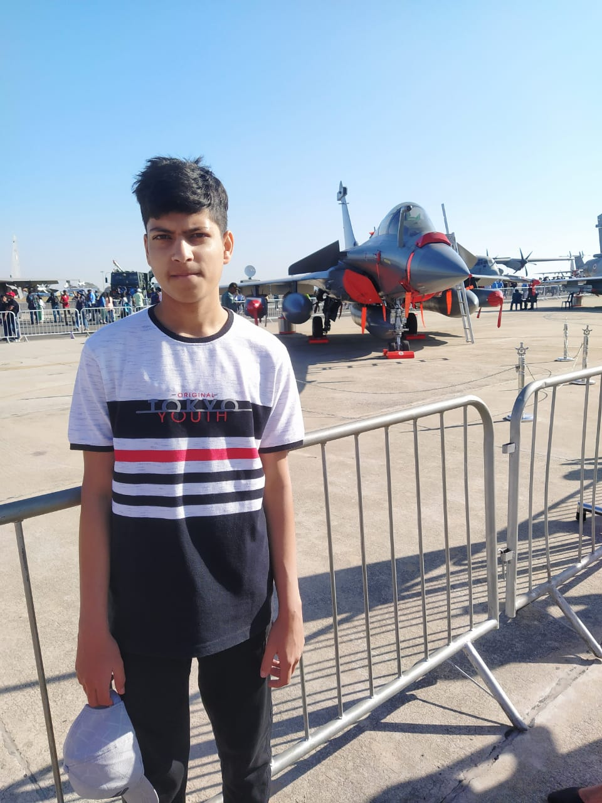

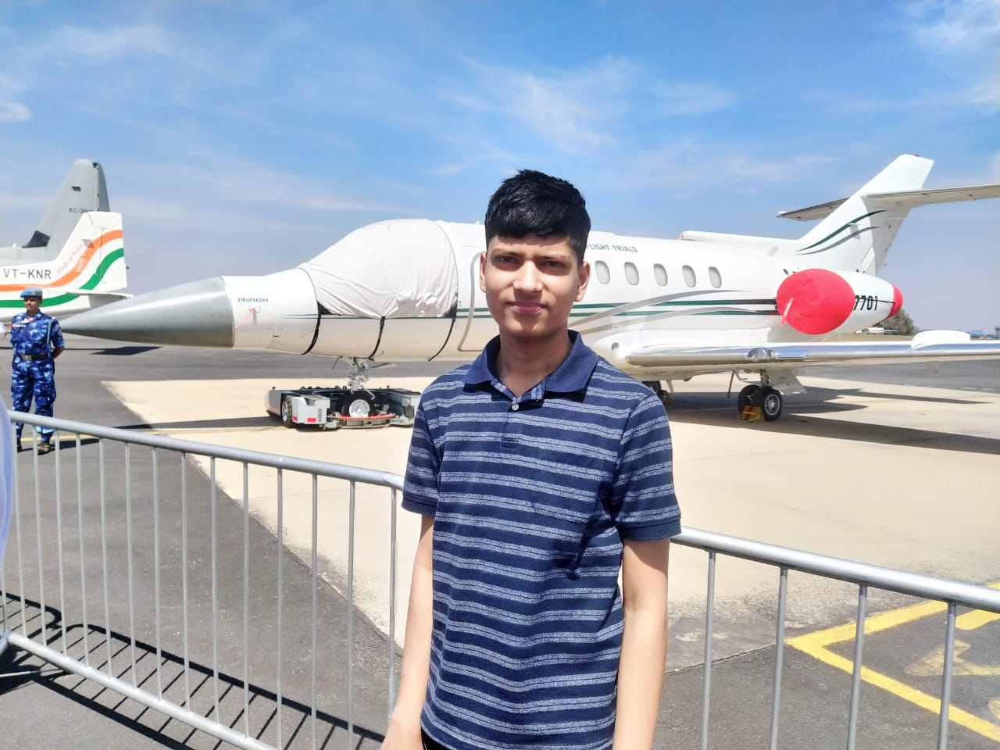

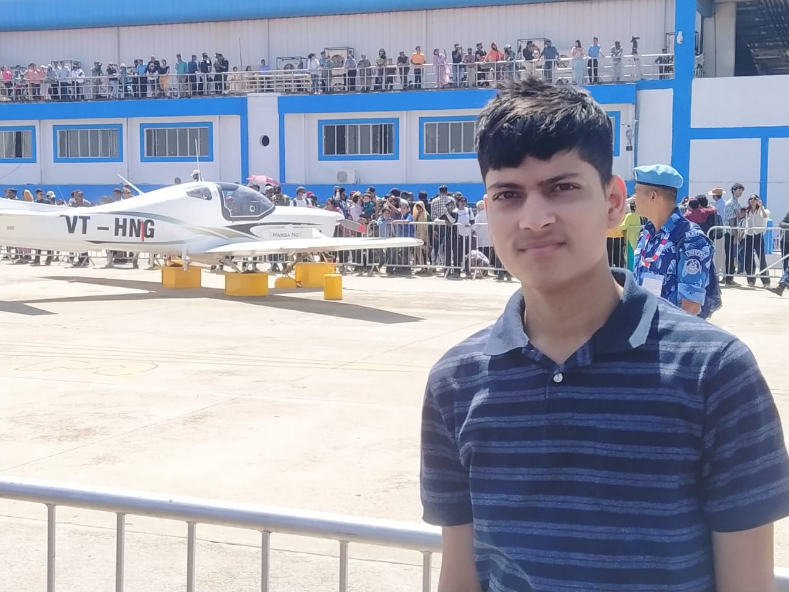

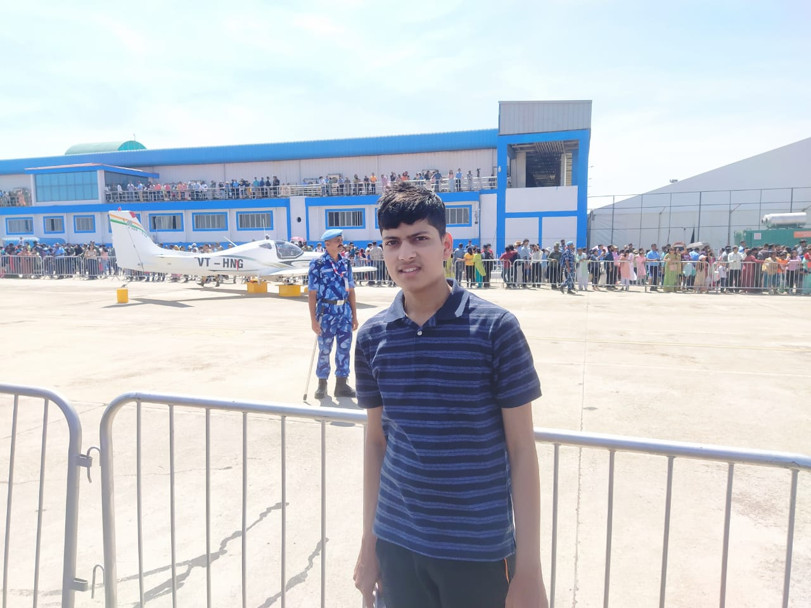

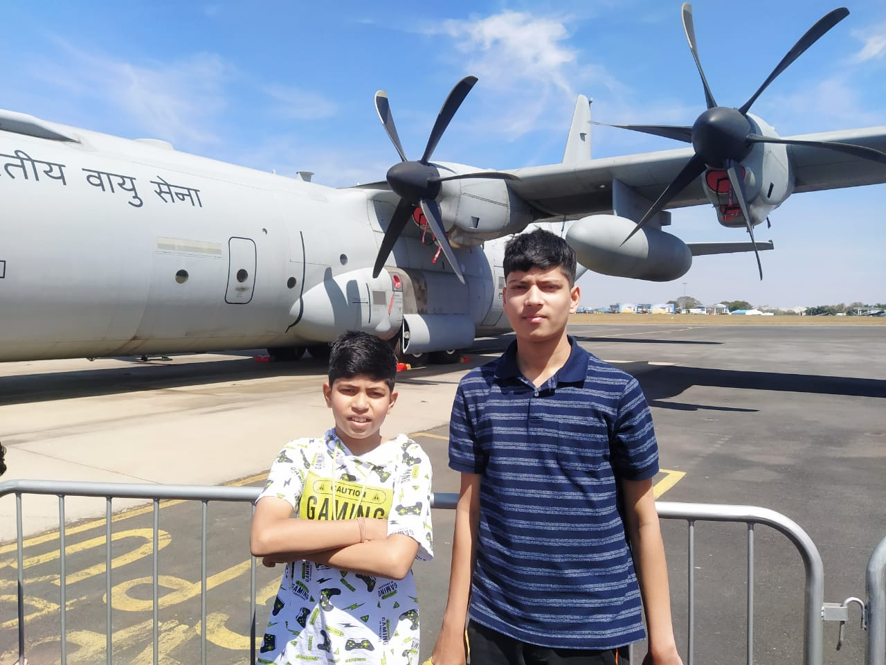

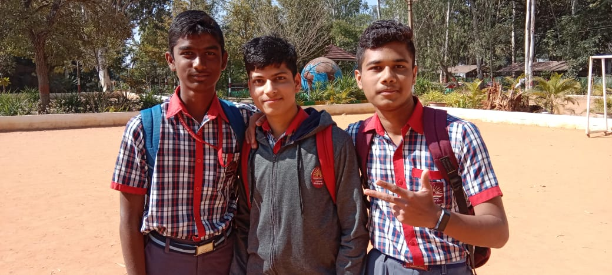

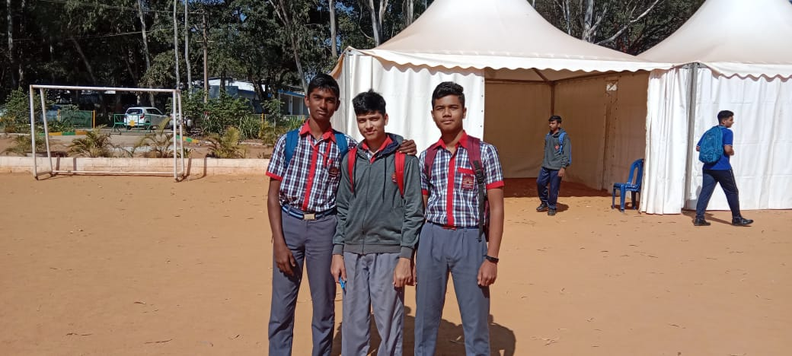

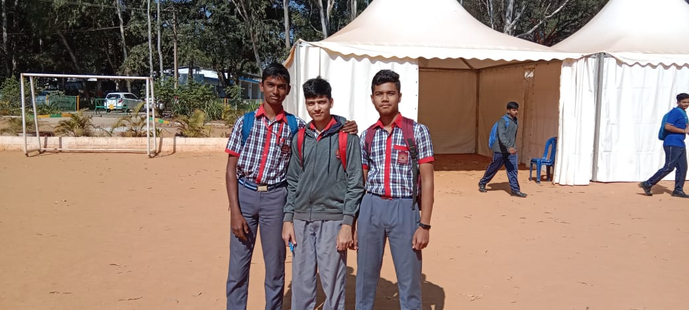

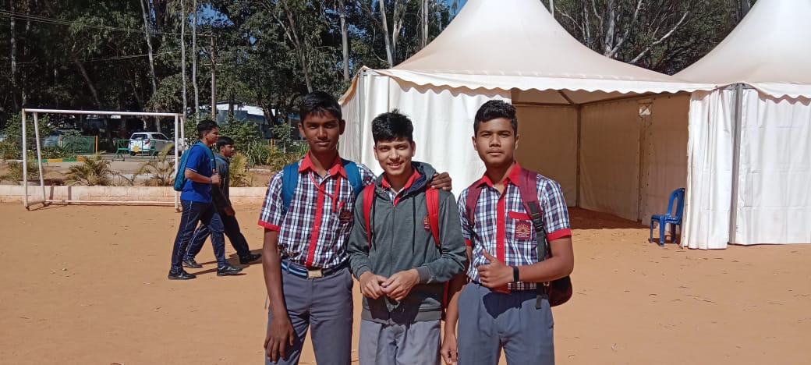

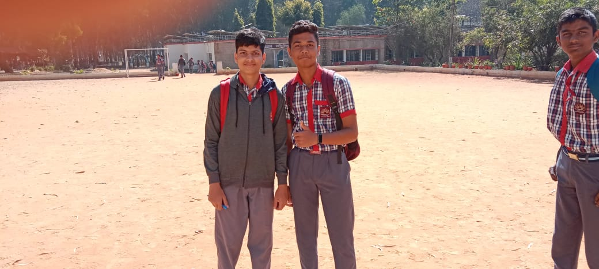
